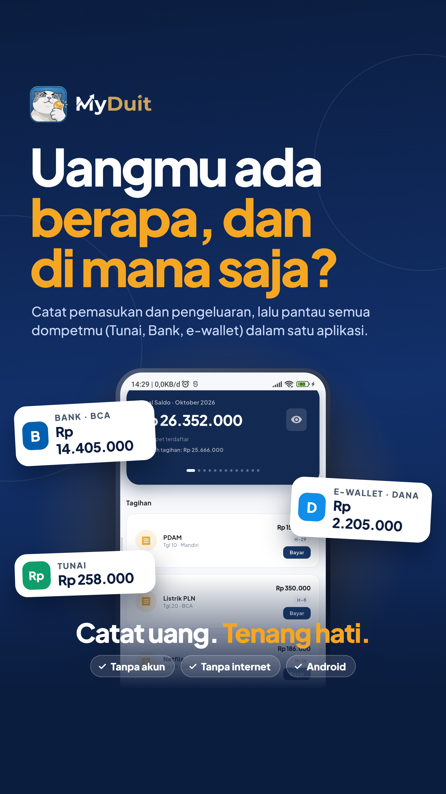

# MyDuit



Aplikasi pencatat keuangan pribadi, lokal-first: semua data tersimpan di perangkat (SQLite), tanpa akun, tanpa server.

## Fitur

### Beranda

- Saldo total + proyeksi saldo hingga 12 bulan ke depan
- Grafik arus 7 hari (keluar/masuk), tagihan belum dibayar, ringkasan dompet
- Mode privasi (sembunyikan nominal), undo hapus

### Laporan

- Ringkasan bulanan per kategori (donut + breakdown)
- Tren 6 bulan / 7 hari dengan pilihan arus keluar/masuk
- Anggaran bulanan per kategori (peringatan ≥80%, over >100%)

### Dompet

- Tunai, bank, e-wallet, kartu; logo brand otomatis
- Kelola brand sendiri (bank / e-wallet / kartu)
- Arsip dompet (data utuh) atau hapus permanen

### Tagihan

- Tagihan bulanan berulang atau cicilan N bulan (otomatis selesai)
- Pengingat notifikasi pukul 08:00 di hari jatuh tempo

### Profil

- Backup ke penyimpanan / pulihkan dari backup (dengan snapshot aman)
- Kelola kategori (tambah, ubah, arsip) & kelola brand
- Kunci app sidik jari/PIN, terkunci otomatis saat ditinggal
- Hapus semua data (konfirmasi ketik HAPUS)

## Teknologi

Flutter · Drift (SQLite) · Riverpod · flutter_local_notifications · local_auth

## Build APK

```bash
flutter pub get
flutter build apk --release
```

APK tersedia di `build/app/outputs/flutter-apk/app-release.apk`.

## Pengembangan

```bash
flutter test        # unit + widget (lihat test/)
flutter analyze
```

Migrasi skema database via Drift `schemaVersion` (saat ini v11) — tabel lama tidak pernah di-drop, hanya kolom/tabel baru.

## Lisensi

MIT — lihat [LICENSE](LICENSE).
